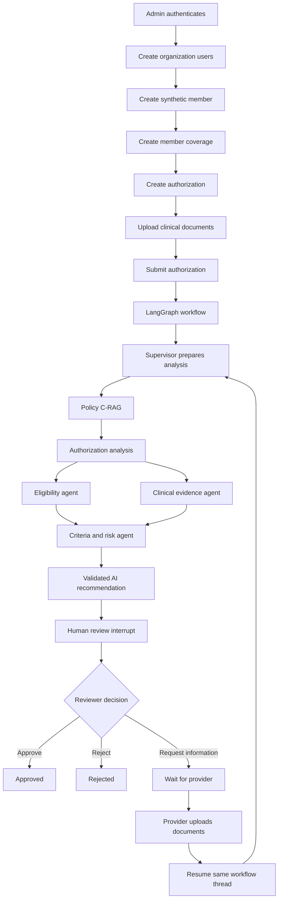
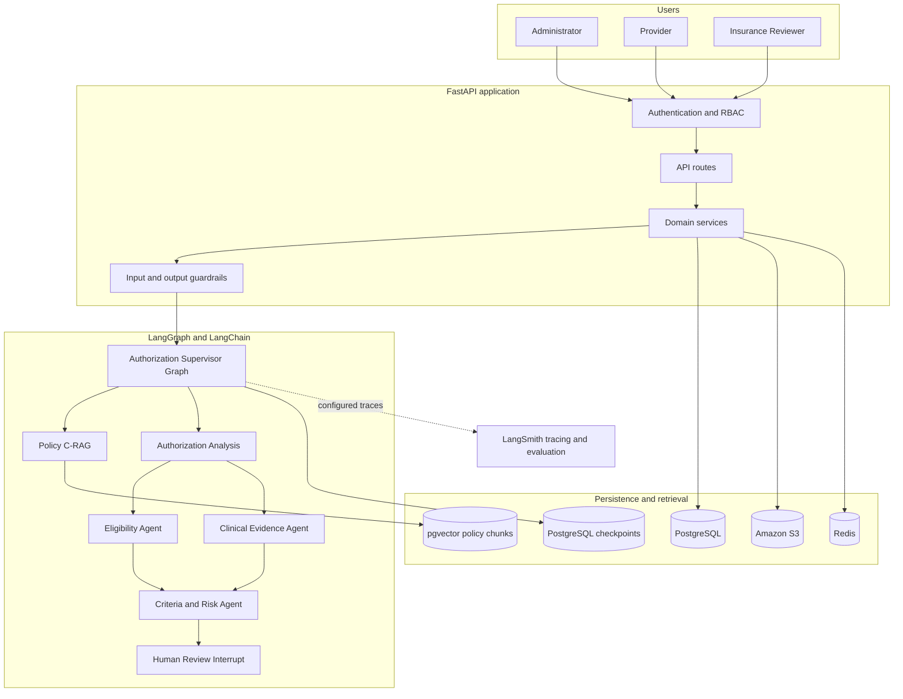
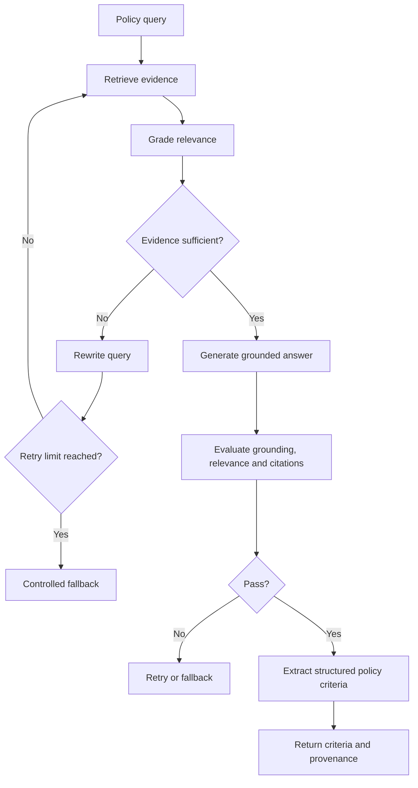
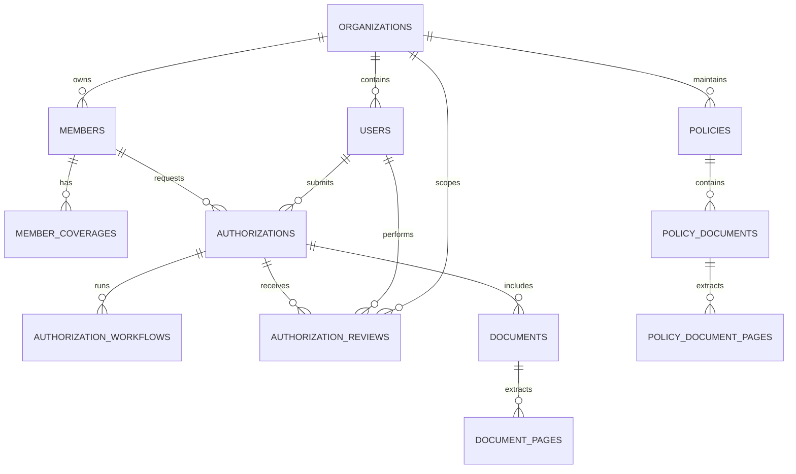
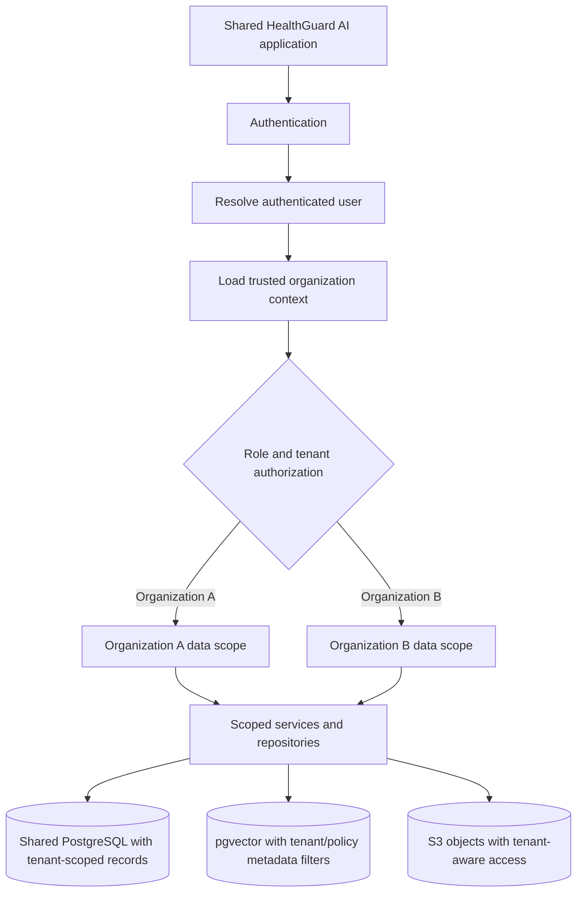
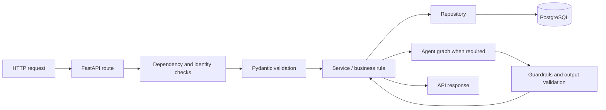
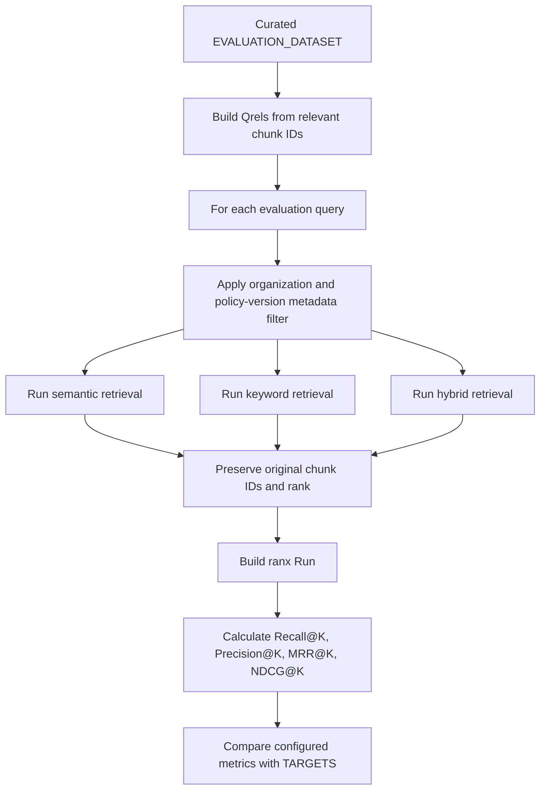

<div align="center">

# HealthGuard AI

### AI-Assisted Prior-Authorization Review Platform

**Policy-grounded analysis · Multi-agent orchestration · Explainable evidence · Human-in-the-loop**

[](https://www.python.org/)
[](https://fastapi.tiangolo.com/)
[](https://langchain-ai.github.io/langgraph/)
[](https://www.postgresql.org/)
[](https://www.docker.com/)
[](https://aws.amazon.com/)

[**Live API Docs**](https://healthguard-ai.duckdns.org/docs) · [**OpenAPI Schema**](https://healthguard-ai.duckdns.org/openapi.json)

</div>

**Author:** Mohammad Ghazi ABBAS

> **Portfolio project:** HealthGuard AI demonstrates an AI-assisted prior-authorization workflow using synthetic data. It is not a medical device, payer production system, or certified HIPAA-compliant service.

[](https://www.python.org/)
[](https://fastapi.tiangolo.com/)
[](https://langchain-ai.github.io/langgraph/)
[](https://www.postgresql.org/)
[](https://aws.amazon.com/ec2/)

**HealthGuard AI** is an AI-assisted prior-authorization review platform. It organizes authorization requests, retrieves applicable policy evidence, evaluates submitted clinical documentation, checks member coverage, identifies missing information and uncertainty, and prepares an explainable recommendation for an authorized human reviewer.

> **Core principle: Automate the analysis, not the final authority.** AI prepares evidence-backed recommendations. An authorized human reviewer retains final decision authority.

This is an independent portfolio engineering project. It is not an Optum product and does not represent Optum's internal systems, proprietary policies, or processes.

---

## Project at a glance

| Item | Description |
|---|---|
| Project | HealthGuard AI |
| Domain | Healthcare prior-authorization workflow |
| Primary interface | FastAPI backend and Swagger UI |
| AI orchestration | LangGraph supervisor and specialist stages |
| Retrieval | Policy RAG / Corrective RAG with PostgreSQL and pgvector |
| Persistence | PostgreSQL, including LangGraph checkpoints |
| Cache | Redis |
| Document storage | Amazon S3 in the AWS deployment |
| Runtime | Docker Compose on AWS EC2 |
| Public API documentation | [healthguard-ai.duckdns.org/docs](https://healthguard-ai.duckdns.org/docs) |
| Frontend | Not implemented in the current project status |
| Test data | Synthetic healthcare data only |

### What this project is — and is not

**It is:** an engineering demonstration of a stateful, evidence-grounded, multi-agent workflow with explicit security checks and a human decision boundary.

**It is not:** an autonomous authorization engine, a clinical recommendation product, a production payer integration, or proof of regulatory compliance.

---

## Contents

- [Problem and objectives](#problem-and-objectives)
- [Key capabilities](#key-capabilities)
- [End-to-end workflow](#end-to-end-workflow)
- [System architecture](#system-architecture)
- [Agent responsibilities](#agent-responsibilities)
- [Policy RAG and C-RAG](#policy-rag-and-c-rag)
- [Human-in-the-loop and checkpointing](#human-in-the-loop-and-checkpointing)
- [Security and privacy](#security-and-privacy)
- [Technology stack](#technology-stack)
- [Data model](#data-model)
- [Repository structure](#repository-structure)
- [Local setup](#local-setup)
- [Configuration](#configuration)
- [Database and vector store](#database-and-vector-store)
- [Testing and evaluation](#testing-and-evaluation)
- [AWS deployment](#aws-deployment)
- [API documentation](#api-documentation)
- [Implementation status and limitations](#implementation-status-and-limitations)
- [Engineering decisions](#engineering-decisions)
- [Future improvements](#future-improvements)
- [Interview walkthrough](#interview-walkthrough)
- [Responsible-use notice](#responsible-use-notice)

---

## Problem and objectives

Prior-authorization review requires a reviewer to reconcile member eligibility, procedure and diagnosis information, payer policy criteria, and clinical evidence across multiple documents. Missing documentation or inconsistent evidence mapping can create avoidable rework.

HealthGuard AI aims to reduce the information-retrieval and evidence-mapping effort while preserving:

1. Human accountability.
2. Explainable policy and clinical evidence.
3. Organization/tenant data isolation.
4. Recoverable long-running workflows.
5. Security controls around untrusted documents and model tools.
6. Auditability of AI workflow events and human decisions.

The MVP focuses on one complete authorization lifecycle using synthetic healthcare data rather than attempting to automate an entire utilization-management organization.

## Key capabilities

- JWT authentication and role-based access control.
- Organization-aware users and authorization workflows.
- Authorization creation, submission, and status tracking.
- Document upload, PDF extraction, and page-level evidence.
- Policy ingestion, chunking, metadata, embeddings, and retrieval.
- PostgreSQL and pgvector policy vector storage.
- Policy RAG and Corrective RAG (C-RAG).
- LangGraph orchestration and specialist agent stages.
- Member eligibility evaluation against coverage and service date.
- Clinical evidence mapping to policy criteria.
- Criteria/risk analysis, uncertainty, and missing-information reporting.
- Structured model outputs and application-side validation.
- Human-in-the-loop review using LangGraph interrupts.
- PostgreSQL-backed LangGraph checkpointing.
- Provider information-request and reanalysis workflow.
- Redis application caching.
- Prompt-injection defenses and provider/tool authorization checks.
- LangSmith tracing/evaluation integration when configured.
- Automated unit, integration, agent, and security tests.
- AWS EC2 deployment with Docker Compose and Caddy HTTPS reverse proxy.

## End-to-end workflow



The diagram describes the intended business lifecycle. Exact screens and route behavior should be checked against the current source code before being described as implemented frontend functionality.

### Lifecycle

1. An administrator provisions organization users and roles.
2. A provider creates a synthetic member and coverage record.
3. The provider creates an authorization with procedure, diagnosis, service date, and clinical context.
4. Documents are validated, stored, and extracted into pages.
5. Submission starts the authorization graph.
6. Policy C-RAG retrieves and evaluates policy evidence and extracts criteria.
7. Eligibility and clinical evidence analysis run as independent branches.
8. Criteria/risk analysis combines the outputs and prepares a recommendation.
9. The graph pauses for an authorized human review.
10. The reviewer approves, rejects, or requests additional information.
11. If information is requested, the provider uploads additional documents and the same workflow thread resumes.
12. Application records and AI traces support audit and evaluation.

## System architecture



### Architectural boundaries

- **FastAPI** exposes authenticated application operations.
- **Services and repositories** implement business rules and data access.
- **LangGraph** controls stateful workflow execution, transitions, interrupts, and resume.
- **LangChain** supports prompts, model integrations, structured outputs, and retrieval.
- **PostgreSQL** stores application entities and workflow checkpoints.
- **pgvector** stores policy embeddings and supports similarity retrieval.
- **Redis** supports application caching.
- **Amazon S3** is used for document object storage in the AWS deployment configuration.
- **LangSmith** provides AI tracing and evaluation when configured.

API authorization remains mandatory; the graph is not a substitute for access control.

## Agent responsibilities

### Supervisor

**Function:** `supervisor_node(state)`  
**Module:** `app/agents/supervisor_agent.py`

Prepares work for the required specialist stages. Inputs include the policy question, availability of active policy versions, and clinical page count. Outputs can include a focused policy-search query, summary, and missing-information observations.

The supervisor coordinates analysis; it does not make the final authorization decision. Explicit graph edges ensure required specialist stages execute.

### Policy RAG / C-RAG

**Module:** `app/agents/policy_crag_graph.py`

Retrieves relevant policy passages, grades relevance, rewrites insufficient queries within configured limits, generates a policy-grounded answer, evaluates that answer, and extracts structured criteria with evidence references.

### Eligibility Agent

**Function:** `eligibility_node(state)`

Uses the eligibility service and coverage records to evaluate whether coverage is valid for the requested service date. Eligibility is a domain/data check, not a medical-necessity assessment.

### Clinical Evidence Agent

**Function:** `clinical_evidence_node(state)`  
**Graph module:** `app/agents/eligibility_and_clinical_evidence_graph.py`

Compares extracted clinical pages with trusted policy criteria. Findings use statuses such as:

| Finding | Meaning |
|---|---|
| `FOUND` | Supporting evidence was identified. |
| `NOT_FOUND` | No supporting evidence was identified in the supplied material. |
| `AMBIGUOUS` | Evidence is unclear or insufficient for a reliable finding. |

The application validates criterion IDs and evidence IDs against trusted inputs. A model-generated reference is not accepted just because the model returned it.

### Criteria / Risk Agent

**Function:** `criteria_risk_node(state)`

Combines eligibility, policy criteria, clinical findings, and missing-information observations. It prepares structured risk, uncertainty, and a recommendation for review. Its result is advisory.

### Human Review

**Function:** `human_review_node(state)`

Creates a review request and pauses execution with LangGraph `interrupt()`. The reviewer can submit `APPROVE`, `REJECT`, or `REQUEST_INFORMATION`, subject to application authorization and workflow-state checks.

### Graph hierarchy

The architecture guide describes three graph levels:

1. **Main Authorization Supervisor Graph** — coordinates the authorization lifecycle.
2. **Policy C-RAG Graph** — retrieves and evaluates policy evidence.
3. **Authorization Analysis Graph** — executes Eligibility and Clinical Evidence as parallel branches.

The main graph waits for both independent analysis branches before moving to Criteria/Risk.

## Policy RAG and C-RAG

Ordinary RAG retrieves passages and uses them as generation context. C-RAG adds corrective retrieval and evaluation steps.



Policy retrieval is scoped using organization identity and applicable active policy-version IDs. This is a critical tenant-isolation boundary.

The vector store uses PostgreSQL/pgvector. The documented configuration uses 768-dimensional policy embeddings. The deployed database was initialized with a `policy_vector_chunks` table and a PostgreSQL full-text GIN index. Do not claim a vector ANN index (HNSW/IVFFlat) unless one has subsequently been created and verified.

**Policy criteria extraction and Criteria/Risk are different responsibilities:**

| Policy criteria extraction | Criteria/Risk Agent |
|---|---|
| Reads policy passages | Reads criteria and case analysis |
| Identifies policy requirements | Compares the case with requirements |
| Produces policy criteria | Produces risk and recommendation |
| References policy evidence | References criteria and clinical evidence |

## Human-in-the-loop and checkpointing

Long-running workflows may wait minutes or hours for a reviewer or provider. The application should not keep an API request open while waiting. LangGraph interrupts and persistent checkpointing provide a durable pause/resume model.

### Reviewer decision interrupt

The graph reaches `human_review_node()` and calls:

```python
reviewer_decision = interrupt(review_request)
```

LangGraph pauses and persists the graph state through the configured checkpointer. The workflow is associated with a `thread_id`. The same ID is supplied when resuming.

Illustrative resume call:

```python
result = graph.invoke(
    Command(
        resume={
            "decision": "APPROVE",
            "notes": "Reviewer comments"
        }
    ),
    config={
        "configurable": {
            "thread_id": workflow.thread_id
        }
    }
)
```

The exact request schema and service method are defined by the repository.

**Important LangGraph detail:** when a node containing an interrupt resumes, that node is re-executed from its beginning until the interrupt call is reached again. Code before an interrupt must be safe to execute again. Side effects before an interrupt require careful ordering and idempotency.

### Requesting additional information

When the reviewer chooses `REQUEST_INFORMATION`, the graph routes to a provider-information node and pauses for an upload. The document service validates and stores the new document, extracts pages, and resumes the same workflow thread. The graph then returns to the supervisor and re-runs the analysis.

**State-management consideration:** if the provider-information node replaces `clinical_pages` with only newly uploaded pages, earlier pages can be lost. The resume service must send all relevant old and new pages, or the graph must safely merge them.

### PostgreSQL checkpointer

The project uses LangGraph's PostgreSQL checkpointer integration (`PostgresSaver`) with a psycopg connection pool. Application startup opens the pool, runs checkpointer setup, compiles the graph with the checkpointer, and makes it available to services.

A `thread_id` identifies one workflow execution history. Checkpointing supports resume after human/provider waits and application restarts, provided the database and checkpoint remain available.

## Workflow states and failure handling

The business workflow and the LangGraph execution state are related but should not be confused:

- **Authorization status** represents the business status of the request.
- **Workflow status** represents the orchestration lifecycle.
- **Graph checkpoint** stores resumable graph state associated with a `thread_id`.

The documented workflow includes states such as `WAITING_FOR_REVIEW`, `REVIEW_RESUMING`, `REVIEW_COMPLETED`, `AWAITING_PROVIDER_INFORMATION`, and `REANALYSIS`. Exact enum values and transition rules must be confirmed in the current schemas, models, and services.

### Expected failure behavior

| Failure | Expected safe behavior |
|---|---|
| No relevant policy evidence | Do not invent a policy answer; retry retrieval within limits or use controlled fallback/review |
| LLM timeout or provider error | Bounded retry, then controlled fallback |
| Invalid structured model output | Schema validation, corrective retry where configured, then fallback |
| Invalid criterion/evidence ID | Reject the unsupported reference rather than accepting model-generated provenance |
| PDF extraction failure | Mark processing as failed and request a valid replacement/additional document |
| Unauthorized provider for task/data class | Block the model call before sending protected content |
| Unauthorized organization access | Reject the request at the application authorization boundary |
| Reviewer submits a stale/invalid decision | Validate authorization and workflow state before resuming |
| Duplicate submission | Use idempotency/business constraints where implemented; verify behavior in the current service/tests |
| Application restart during a paused workflow | Recover from PostgreSQL checkpoint using the original workflow `thread_id` |
| Agent loop or repeated correction | Enforce iteration/time limits and route to a controlled terminal path |

These are design expectations from the product requirements. A row should only be described as implemented after its corresponding code and automated test have been verified.

---

## Security and privacy

Uploaded clinical documents are untrusted content. Instructions inside a PDF must never override system instructions, application controls, reviewer authority, or tool permissions.

Security layers include:

- JWT authentication.
- Role-based access control and organization/tenant checks.
- Pydantic/API input validation and file validation.
- File-size limits and controlled document processing.
- Prompt-injection defense and separation of untrusted document text from instructions.
- Explicit tool authorization and argument validation.
- Provider authorization based on task and data classification.
- Structured output validation.
- Validation of criterion and evidence references against trusted application records.
- Tenant-scoped policy retrieval.
- Protected secrets and least-privilege cloud permissions.
- Audit records for security-relevant actions and reviewer decisions.

### PHI-aware provider routing

The application must not send PHI to a model provider unless that provider, task, configuration, and required authorization/compliance controls explicitly permit it. Provider authorization is a hard application gate. If a provider is not authorized for a task containing PHI, the operation must be blocked or routed to an approved alternative.

### Synthetic-data-only policy

**Use synthetic healthcare data only. Do not upload real patient records or production PHI.** Synthetic data is still protected by access controls, tenant boundaries, secrets handling, and storage safeguards.

This project does not claim HIPAA certification or regulatory compliance. Real-world use would require separate legal, security, privacy, vendor, operational, and compliance review.

## Technology stack

| Area | Technology |
|---|---|
| Language | Python |
| API | FastAPI, Uvicorn |
| Validation/settings | Pydantic, Pydantic Settings |
| ORM/migrations | SQLAlchemy, Alembic |
| Relational database | PostgreSQL 16 |
| Vector retrieval | pgvector |
| AI orchestration | LangGraph |
| LLM framework | LangChain |
| Checkpointing | LangGraph PostgreSQL checkpointer / PostgresSaver |
| PostgreSQL driver | psycopg 3 |
| Cache | Redis |
| Document processing | PDF extraction utilities |
| Object storage | Amazon S3 |
| Observability | LangSmith, when configured |
| Containers | Docker, Docker Compose |
| Cloud | AWS EC2, ECR, S3 |
| HTTPS reverse proxy | Caddy |
| DNS | DuckDNS |

Model providers and model identifiers are configuration-driven. Check the active environment/model registry for the exact models enabled at runtime.

## Database architecture and relationships

HealthGuard AI uses PostgreSQL as its primary relational database. The relational schema stores organization, identity, member, coverage, authorization, document, policy, and review data. pgvector stores policy embeddings alongside chunk metadata. LangGraph checkpoint storage is managed by the PostgreSQL checkpointer integration.

### Main relational entities

| Entity / table | Purpose | Key relationships |
|---|---|---|
| `organizations` | Represents a tenant/customer organization | Parent of organization-scoped users, members, and policies |
| `users` | Authenticated actors such as administrators, providers, and reviewers | Belongs to an organization; referenced by authorization and review records |
| `members` | Synthetic members whose coverage and authorization are evaluated | Belongs to an organization; can have multiple coverage records and authorizations |
| `member_coverages` | Coverage periods and eligibility inputs | References a member; evaluated against the authorization service date |
| `authorizations` | A request for a procedure/service for a member | References the member and submitting user; parent of workflow, document, and review activity |
| `authorization_workflows` | Tracks workflow execution and business lifecycle metadata | Associated with an authorization; stores/relates to the LangGraph `thread_id` |
| `authorization_reviews` | Records reviewer actions and review history | References the authorization, reviewer user, and organization context |
| `documents` | Metadata for uploaded clinical documents | Associated with an authorization; parent of extracted pages |
| `document_pages` | Extracted clinical page text and page metadata | References a source document |
| `policies` | Organization policy metadata and active status/version context | Belongs to an organization; parent of policy documents |
| `policy_documents` | Metadata and processing state for policy source files | References a policy; parent of extracted policy pages |
| `policy_document_pages` | Extracted policy pages | References a policy document |
| `policy_vector_chunks` | Policy chunk text, embedding, and retrieval metadata | Carries organization, policy version, document, page, and chunk identifiers |
| `alembic_version` | Tracks the relational schema migration revision | Maintained by Alembic |

### Relationship overview

The following ER diagram expresses the domain relationships at a conceptual level. Confirm exact foreign keys, optionality, uniqueness, and cascade behavior in the SQLAlchemy models and Alembic migrations.



### How the data relates during an authorization

1. An `organizations` record establishes the tenant boundary.
2. A `users` record identifies the authenticated actor and their organization/role.
3. A `members` record belongs to the organization.
4. One member may have multiple `member_coverages` records covering different effective-date ranges.
5. An `authorizations` record represents one requested service for that member and service date.
6. Clinical `documents` are associated with the authorization; extracted `document_pages` provide page-level evidence for the Clinical Evidence Agent.
7. The applicable organization policy is represented by `policies`, `policy_documents`, and `policy_document_pages`.
8. Policy pages are split into `policy_vector_chunks`, with embeddings and provenance metadata used for retrieval.
9. An `authorization_workflows` record tracks execution status and the LangGraph thread association.
10. `authorization_reviews` records reviewer actions and comments against the authorization.

### Why coverage is separate from member

Coverage changes over time. Eligibility must be evaluated for the requested service date, not merely by checking whether a member exists or has any coverage record. The service must identify the applicable coverage period and apply the configured eligibility rules.

### Why documents and pages are separate

The document record represents the uploaded file and its processing lifecycle. Page records represent extracted content and provenance. This supports page-level clinical evidence references, document processing status, and reprocessing without treating extracted text as the original source file.

### Relational data versus vector data

- Relational tables are the source of truth for users, organizations, coverage, authorization status, document metadata, and review decisions.
- `policy_vector_chunks` is a retrieval representation of policy text. It must not become the authority for organization ownership or authorization permissions.
- Vector metadata should retain organization ID, policy version ID, document ID, page number, and chunk identity so retrieval results can be traced back to source policy content.
- LangGraph checkpoint tables store execution state and are operational workflow persistence, not a replacement for the business authorization/review tables.

---

## Multi-tenant SaaS architecture and data isolation

HealthGuard AI is designed with a multi-tenant SaaS model: multiple customer organizations can use the same application deployment while their users, members, authorizations, policies, documents, and review records remain logically isolated.

### Tenant model



A shared application/database deployment is a logical multi-tenant design. It should not be described as physical database-per-tenant isolation unless separate databases or schemas are actually provisioned.

### Tenant isolation rules

1. **Trusted tenant context:** derive the organization ID from the authenticated user/session and trusted server-side authorization context. Do not trust an organization ID supplied only by the request body.
2. **Role-based access:** validate both the user's role and organization membership before an operation.
3. **Repository scoping:** every organization-owned read, update, and delete must include the authorized organization scope.
4. **Object-level authorization:** checking a user's role is not enough; verify that the requested member, authorization, document, policy, or review belongs to the user's organization.
5. **Policy retrieval filtering:** semantic, keyword, and hybrid retrieval must filter by the authenticated organization and the allowed policy version IDs.
6. **Vector metadata isolation:** every policy chunk must carry trusted tenant and policy provenance metadata. The filter must be applied before ranking results are exposed to the agent.
7. **Document storage isolation:** authorize the document through its database ownership relationship before issuing an S3 read, download, or delete operation. Use tenant-aware object keys and least-privilege IAM access.
8. **Workflow isolation:** validate the organization and authorization before allowing access to a graph `thread_id`, checkpoint, or resume operation. A thread ID is an identifier, not an authorization credential.
9. **Cache isolation:** include organization and relevant authorization scope in cache keys. Never allow a response cached for one tenant to be returned to another.
10. **Audit context:** record the authenticated actor, organization, target resource, action, and outcome without unnecessarily copying sensitive document content into logs.
11. **Background jobs:** carry an explicit trusted organization context into asynchronous tasks; do not rely on a missing request context.
12. **Negative tests:** prove that a user from Organization A cannot read or mutate Organization B's records, policy chunks, documents, review queue, or workflow state.

### Example of organization-scoped SQL

A lookup should scope the resource by both its identifier and the trusted tenant identifier, where the schema exposes that tenant key directly:

```sql
SELECT *
FROM authorizations
WHERE id = :authorization_id
  AND organization_id = :trusted_organization_id;
```

If the authorization table does not store `organization_id` directly, enforce the equivalent scope through trusted joins (for example, through the member or submitting user relationship). Use the actual foreign-key path in the repository; do not assume the column exists.

A query such as:

```sql
SELECT *
FROM authorizations
WHERE id = 46
  AND id = 43;
```

is not a tenant-isolation query: it asks for one row whose same primary key is simultaneously 46 and 43, so it will normally return no rows. The tenant predicate must use the tenant/organization key, not repeat the authorization primary key.

### Isolation testing matrix

| Test | Expected result |
|---|---|
| Organization A user requests Organization B authorization | Denied / not found according to API policy |
| Organization A user requests Organization B member | Denied |
| Organization A user queries policy retrieval | Only Organization A's permitted policy versions are eligible |
| Organization A user downloads Organization B document | Denied before object access |
| Reviewer accesses another organization's review queue | Denied |
| User submits another tenant's `thread_id` to resume a graph | Denied |
| Cache key is reused across different organizations | Separate cache entries; no cross-tenant response |
| Client changes `organization_id` in request payload | Server ignores/rejects untrusted tenant override |

These are the isolation requirements and test cases to maintain. Only mark each test as passing when the corresponding automated test exists and passes.

## Repository structure and code responsibilities

The backend follows a layered structure. The goal is to keep HTTP concerns, business rules, persistence, AI orchestration, and security controls separate.

```text
healthguard-ai/
├── app/
│   ├── agents/                 # LangGraph graphs, nodes, agent prompts and state
│   ├── api/
│   │   ├── dependencies.py     # Shared request dependencies and access context
│   │   └── routes/             # HTTP endpoints grouped by domain
│   ├── cache/                  # Redis client and cache helpers
│   ├── core/                   # Settings, configuration and shared application setup
│   ├── db/                     # SQLAlchemy sessions, database and checkpointer lifecycle
│   ├── models/                 # SQLAlchemy relational models
│   ├── rag/                    # Policy retrieval, embeddings and vector-store integration
│   ├── repositories/           # Database queries and persistence operations
│   ├── schemas/                # Pydantic request, response and structured AI schemas
│   ├── security/               # Authentication, authorization and security validation
│   ├── services/               # Business workflows and orchestration between layers
│   └── main.py                 # FastAPI application and lifespan management
├── alembic/
│   ├── versions/               # Versioned relational database migrations
│   └── env.py                  # Alembic configuration and metadata
├── scripts/                    # Operational initialization and index scripts
├── tests/
│   ├── agents/                 # Agent and graph behavior tests
│   ├── security/               # Provider, ingestion and security tests
│   └── ...                     # Unit, integration and workflow tests
├── Dockerfile
├── docker-compose.yml
├── docker-compose.aws.yml
├── requirements.txt
├── .env.example
└── README.md
```

### Layer-by-layer responsibilities

| Layer | Responsibility | Examples of what belongs here |
|---|---|---|
| `api/routes` | Translate HTTP requests into service calls and return API responses | Authentication, members, coverages, policies, authorizations, reviews |
| `schemas` | Validate incoming/outgoing data and define structured AI output contracts | Pydantic request models, response models, criteria/evidence schemas |
| `services` | Apply business rules and coordinate repositories, documents, and graphs | Authorization submission, review decisions, document processing |
| `repositories` | Encapsulate database reads and writes | Fetch authorization by organization, persist review history |
| `models` | Define relational entities and relationships | User, Organization, Member, Coverage, Authorization, Document |
| `agents` | Define graph state, nodes, prompts, routing, and agent composition | Supervisor, Policy C-RAG, eligibility/clinical graph, criteria/risk |
| `rag` | Implement retrieval and vector-store behavior | Embeddings, PGVectorStore, policy search |
| `security` | Enforce security rules independently of model instructions | JWT validation, provider authorization, tenant checks |
| `db` | Manage database sessions and graph checkpoint resources | SQLAlchemy session factory, PostgresSaver pool |
| `cache` | Manage cache connection and cache operations | Redis client |
| `core` | Central application configuration | Environment settings and shared constants |
| `tests` | Verify expected behavior and security boundaries | Unit, integration, agent, security, and E2E tests |

### Request-to-database execution path

A typical API operation follows this direction:



Routes should remain thin. Business decisions belong in services or deterministic domain components, database access belongs in repositories, and model output must be validated before it changes business state.

## Domain model and relationship knowledge

The core business entities represent an organization-scoped authorization process:

- **Organization** is the tenant boundary.
- **User** is an authenticated actor associated with an organization and role.
- **Member** represents the person whose coverage and authorization are being evaluated. The MVP uses synthetic members.
- **Member Coverage** records coverage periods and related eligibility inputs.
- **Authorization** represents a request for a procedure/service for a member and service date.
- **Document** represents an uploaded file associated with an authorization or policy workflow.
- **Document Page** represents extracted page-level text and metadata used for evidence analysis.
- **Policy** represents an organization's policy definition/version context.
- **Policy Document** and **Policy Document Page** represent the source policy files and extracted pages.
- **Policy Vector Chunk** stores chunk text, embedding, and retrieval metadata for semantic/hybrid policy search.
- **Authorization Workflow** tracks the orchestration lifecycle and graph thread association.
- **Authorization Review** records a human review action and its audit context.

### Why keep these entities separate?

A member can have multiple coverage records over time. An authorization is a specific request tied to a service date, so eligibility must be evaluated against the coverage effective on that date. A document is stored separately from its extracted pages because file metadata/lifecycle and page-level evidence have different responsibilities. Policy documents and clinical documents also remain distinct: policy content describes requirements; clinical content describes the submitted case.

### Data ownership and isolation

Organization context must be enforced at the API, service, repository, and retrieval boundaries. Filtering only in the UI is not sufficient. Policy retrieval must be restricted to the requesting organization's applicable policy versions. A graph state or model prompt must never be treated as the authority for tenant access.

## Authorization workflow: state and responsibility boundaries

The authorization workflow coordinates deterministic business operations and probabilistic model analysis.

| Stage | Primary responsibility | Trusted source of truth |
|---|---|---|
| Identity | Establish caller identity and role | Authenticated token and database user |
| Authorization draft | Create and validate request | SQLAlchemy authorization/member records |
| Document intake | Validate, store, extract and persist pages | File validation, object storage, document tables |
| Policy retrieval | Find applicable policy evidence | Organization-scoped policy records and vector store |
| Policy criteria extraction | Convert policy evidence into structured criteria | Retrieved policy pages and validated evidence IDs |
| Eligibility | Evaluate coverage for service date | Coverage records and deterministic eligibility rules |
| Clinical evidence | Map submitted pages to policy criteria | Persisted clinical pages and trusted criterion IDs |
| Criteria/risk | Summarize gaps, uncertainty and evidence-backed recommendation | Validated outputs from specialist stages |
| Human review | Approve, reject, or request information | Authenticated reviewer action and review record |
| Resume/reanalysis | Continue paused workflow after provider upload | Original checkpoint/thread and validated upload event |

The LLM is not the source of truth for identity, coverage dates, organization ownership, workflow permissions, or final reviewer decisions. Those must be enforced by application code and persisted records.

## Local setup

### Prerequisites

- Git.
- Python compatible with the repository image (documented Docker image currently uses Python 3.14).
- Docker Desktop and Docker Compose.
- LLM provider credentials if running live model calls.

### 1. Clone

```bash
git clone <YOUR_GITHUB_REPOSITORY_URL>
cd healthguard-ai
```

### 2. Create a virtual environment (optional for local Python execution)

Windows PowerShell:

```powershell
python -m venv .venv
.\.venv\Scripts\Activate.ps1
```

macOS/Linux:

```bash
python -m venv .venv
source .venv/bin/activate
```

### 3. Install dependencies

```bash
python -m pip install --upgrade pip
pip install -r requirements.txt
```

### 4. Configure environment

Windows PowerShell:

```powershell
Copy-Item .env.example .env
```

Set required values in `.env` locally. Never commit `.env`, `app.env`, passwords, API keys, JWT secrets, cache secrets, or cloud credentials.

### 5. Start local services

If the repository's local Compose file is configured for your environment:

```bash
docker compose up --build -d
docker compose ps
docker compose logs -f app
```

Service names and exposed ports are defined in the Compose file. Do not expose PostgreSQL or Redis publicly.

### 6. Apply migrations

Run from the application container when the database hostname is the Compose service name:

```bash
docker compose exec app alembic upgrade head
```

If running Alembic directly on Windows, use a hostname and port reachable from Windows. The Compose hostname `postgres` normally resolves only inside the Docker network.

### 7. API docs

When the local API is running, open `http://localhost:8000/docs` (or the port mapped by your Compose configuration).

## Configuration

`.env.example` documents the configuration shape. Typical settings:

| Variable | Purpose |
|---|---|
| `APP_ENV` | Application environment |
| `DATABASE_URL` | SQLAlchemy PostgreSQL connection |
| `LANGGRAPH_CHECKPOINTER_URL` | Psycopg checkpoint connection |
| `REDIS_URL` | Redis connection |
| `JWT_SECRET_KEY` | JWT signing secret |
| `JWT_ALGORITHM` | JWT algorithm |
| `JWT_ACCESS_TOKEN_EXPIRE_MINUTES` | Access-token lifetime |
| `CACHE_KEY_SECRET` | Cache-key protection/derivation |
| `AWS_REGION` | AWS region |
| `AWS_S3_BUCKET` | Document storage bucket |
| `S3_SERVER_SIDE_ENCRYPTION` | S3 server-side encryption setting |
| `GROQ_API_KEY` | Groq credential, if enabled |
| `GOOGLE_API_KEY` | Google model/embedding credential, if enabled |
| `GROQ_MODEL` | Configured primary Groq model |
| `GROQ_FAST_MODEL` | Configured faster Groq model |
| `GEMINI_EVAL_MODEL` | Configured evaluation model |
| `AI_MODEL_TIMEOUT` | Model-call timeout |
| `AI_MODEL_MAX_RETRIES` | Bounded model retry count |
| `MAX_FILE_SIZE_MB` | Upload size limit |
| `LANGSMITH_TRACING` | Enables/disables tracing |
| `LANGSMITH_ENDPOINT` | LangSmith endpoint |
| `LANGSMITH_API_KEY` | LangSmith credential |
| `LANGSMITH_PROJECT` | LangSmith project |

Use separate secrets and least-privilege identities for development and deployment. `.env.example` must contain placeholders only.

## Database and vector store

Alembic manages relational schema migrations:

```bash
alembic upgrade head
alembic current
alembic history
```

The policy vector store is initialized separately:

```bash
python -m scripts.init_policy_vectorstore
```

The policy search index setup script is:

```bash
python -m scripts.create_policy_search_indexes
```

Run these commands only in the environment connected to the intended database. Confirm the target database and take a backup before persistent schema changes.

**Migration discipline:** after a migration has been applied to a shared or deployed database, treat it as immutable. Introduce future schema changes through new forward migrations.

## Testing and evaluation

Run the suite:

```bash
python -m pytest tests -q
```

Focused security tests:

```bash
python -m pytest tests/security/test_provider_authorization.py -q
python -m pytest tests/security/test_policy_ingestion_security.py -q
```

The full suite and focused security tests have previously reported passing results in the development environment. Re-run tests on the exact commit being evaluated and publish current output rather than relying on historical results.

Recommended coverage:

- Unit tests for services, repositories, and deterministic business rules.
- Integration tests for PostgreSQL, Redis, document storage, and APIs.
- Agent tests for schema validity, evidence references, policy grounding, and fallback.
- Security tests for tenant isolation, provider authorization, prompt injection, and unauthorized access.
- Reliability tests for timeouts, retries, idempotency, checkpoint recovery, and bounded loops.
- E2E tests for submission, analysis, human review, information request, provider upload, reanalysis, and final reviewer decision.

### Initial evaluation targets from the PRD

These are proposed acceptance thresholds, not measured results:

| Metric | Initial target |
|---|---:|
| Policy retrieval Recall@K | ≥ 0.90 |
| Mean Reciprocal Rank (MRR) | ≥ 0.80 |
| Citation accuracy | ≥ 0.95 |
| Human acceptance on benchmark cases | ≥ 80% |
| Criteria provenance coverage | ≥ 95% |
| Correct agent routing | ≥ 95% |
| Structured-output validity after validation/retry | ≥ 99% |
| Valid synthetic E2E case completion | ≥ 99% |

## RAG evaluation and retrieval benchmarking

The project includes a retrieval evaluation workflow that compares three retrieval strategies against a curated relevance dataset:

- **Semantic retrieval** — vector similarity retrieval.
- **Keyword retrieval** — BM25-style keyword retrieval over policy chunks.
- **Hybrid retrieval** — combines semantic and keyword retrieval behavior.

The evaluation script uses `ranx` (`Qrels`, `Run`, and `evaluate`) to compare ranked retrieved chunk IDs against known relevant chunk IDs.

### Evaluation workflow



### Evaluation implementation details

The evaluation code:

1. Loads the curated `EVALUATION_DATASET`.
2. Builds `Qrels` from each query's `relevant_chunks`.
3. Uses the configured `TOP_K` value (the reported run uses `K = 5`).
4. Applies metadata filtering using both `organization_id` and the allowed `policy_version_ids`.
5. Runs semantic, keyword, and hybrid retrievers independently.
6. Preserves original chunk IDs in the ranked run so relevance labels can be matched.
7. Assigns descending ranking scores to retrieved chunks.
8. Uses `ranx.evaluate()` to calculate the configured metrics.
9. Compares metric values with configured `TARGETS` and reports `PASS` or `BELOW TARGET`.

The keyword evaluation loader also checks a maximum corpus size and validates that returned IDs, texts, and metadata arrays have consistent lengths. On Windows, the script selects `WindowsSelectorEventLoopPolicy` because the configured async psycopg connection path requires a SelectorEventLoop.

### Measured retrieval results

The following are the actual results supplied from the project's evaluation run, with `TOP_K = 5`:

| Metric | Semantic | Keyword | Hybrid |
|---|---:|---:|---:|
| Recall@5 | **0.944 — PASS** | 0.472 — BELOW TARGET | 0.889 — BELOW TARGET |
| Precision@5 | 0.467 | 0.233 | 0.433 |
| MRR@5 | **0.889 — PASS** | 0.500 — BELOW TARGET | **0.889 — PASS** |
| NDCG@5 | **0.863** | 0.391 | 0.787 |

Configured targets shown in the run:

- Recall@5: `0.90`
- MRR@5: `0.80`

### Interpretation

- **Semantic retrieval** achieved the strongest measured Recall@5 and NDCG@5 in this evaluation run. It exceeded both configured targets.
- **Keyword retrieval** underperformed on recall, precision, MRR, and NDCG. This indicates that keyword-only retrieval needs improvement for this evaluation corpus.
- **Hybrid retrieval** achieved the target MRR@5 but narrowly missed the Recall@5 target (`0.889` versus `0.90`). It ranked relevant evidence early in many queries but did not retrieve enough of all relevant chunks to meet the recall target.
- The results do not establish that semantic retrieval is universally superior. They describe this dataset, query set, policy corpus, filters, retriever configuration, and run only.

### Evaluation limitations and next steps

- The results are based on the curated evaluation dataset and should be accompanied by dataset size, query coverage, and relevance-label review in future reports.
- Re-run the benchmark after changing chunking, embeddings, metadata filters, retriever settings, or policy content.
- Investigate keyword preprocessing, tokenization, corpus construction, and BM25 parameters.
- Tune hybrid retrieval and fusion/ranking behavior to improve recall without degrading ranking quality.
- Add more queries, policies, organizations, edge cases, and hard negatives.
- Track metric changes across commits so retrieval regressions are visible.
- Retrieval metrics evaluate ranked evidence retrieval; they do not by themselves measure answer faithfulness, citation correctness, agent routing, clinical accuracy, or end-to-end authorization quality.

**Important:** evaluation is implemented and has been run for semantic, keyword, and hybrid retrieval. The measured results are mixed: semantic passed both configured targets, hybrid passed MRR but missed recall, and keyword missed both. Do not describe all three retrieval methods as passing.

## Testing strategy and test results

Testing is organized around the boundaries that matter to this system: deterministic business logic, database/API behavior, AI graph behavior, security controls, workflow recovery, and retrieval quality.

### Test layers

| Test layer | What it verifies | Examples |
|---|---|---|
| Unit tests | Small deterministic components | Eligibility date rules, schema validation, repository/service behavior |
| API tests | HTTP contracts and access controls | Authentication, role permissions, request validation, response status |
| Database integration tests | Persistence and relational constraints | SQLAlchemy models, repositories, Alembic schema, transaction behavior |
| RAG tests | Retrieval and provenance behavior | Metadata filtering, chunk IDs, page references, empty retrieval |
| Agent/graph tests | Node behavior and graph transitions | Structured output, routing, specialist outputs, controlled fallback |
| Security tests | Trust boundaries and data protection | Provider authorization, policy-ingestion validation, prompt injection, tenant isolation |
| HITL tests | Pause/resume behavior | `interrupt()`, `Command(resume=...)`, reviewer decisions, provider re-upload |
| Reliability tests | Recovery from operational failures | Timeouts, retries, idempotency, checkpoint recovery, loop limits |
| End-to-end tests | Complete synthetic authorization lifecycle | Submit, analyze, review, request information, upload, reanalyze, final decision |
| Retrieval evaluation | Ranked retrieval quality | Recall@5, Precision@5, MRR@5, NDCG@5 |

### Test commands

Run the full suite:

```powershell
python -m pytest tests -q
```

Run the provider-authorization security tests:

```powershell
python -m pytest tests/security/test_provider_authorization.py -q
```

Run policy-ingestion security tests:

```powershell
python -m pytest tests/security/test_policy_ingestion_security.py -q
```

Run the retrieval benchmark using the repository's actual evaluation module/script entry point. For example, if the code is saved as `scripts/evaluate_retrieval.py`:

```powershell
python -m scripts.evaluate_retrieval
```

Use the actual module path in the repository if it differs.

### Previously reported automated test results

The following results were previously reported during development:

| Test command / test | Reported result |
|---|---:|
| `tests/security/test_provider_authorization.py` | 11 passed |
| `tests/security/test_policy_ingestion_security.py` | 2 passed |
| Full `python -m pytest tests -q` run | All tests passed at that time |
| `test_clinical_evidence_mock_with_phi` | Passed |
| `test_clinical_evidence_mock_rejects_secret` | Passed |

These are historical development results, not a guarantee that the current GitHub commit passes. Re-run the suite against the exact commit you publish and update this section with the latest output.

### What a passing test suite does and does not prove

Passing automated tests demonstrate that the tested code paths behaved as expected under the test inputs. They do not prove that every possible tenant-isolation attack, prompt injection, model hallucination, production outage, or regulatory requirement has been addressed. Security and reliability claims should be tied to explicit tests, threat models, and deployment controls.

---

## AWS deployment

The backend has been deployed using a container-based AWS setup.

### Components

- **Amazon EC2** — hosts the application stack.
- **Amazon ECR** — stores the backend container image.
- **Docker Compose** — runs API, PostgreSQL, Redis, and Caddy.
- **PostgreSQL with pgvector** — relational and policy-vector storage.
- **Redis** — application cache.
- **Amazon S3** — document object storage.
- **Caddy** — HTTPS reverse proxy and certificate management.
- **DuckDNS** — DNS name for the API endpoint.
- **AWS Systems Manager Session Manager** — administrative access without public SSH.
- **EC2 IAM role** — AWS access without static AWS keys in the application environment.

### Public API

**Swagger / OpenAPI:** https://healthguard-ai.duckdns.org/docs

The endpoint returned HTTP 200 with successful TLS verification on November 14, 2026. Availability can change if the EC2 instance is stopped, its public IP changes, or DNS is not updated.

### Deployment security

- PostgreSQL, Redis, and the internal API port are not intended to be publicly exposed.
- Public ingress is through the HTTPS reverse proxy.
- Server secrets are held in protected environment files and must not be committed.
- The EC2 instance uses an IAM role for AWS access.
- Synthetic data only.
- Review AWS costs, storage, public IPv4 charges, and instance state when the environment is not in use.

This demonstrates a working portfolio deployment. It is not a claim of production-scale high availability, formal HIPAA compliance, or enterprise disaster recovery.

## API surface and request lifecycle

The API is organized into route modules under `app/api/routes/`. The exact paths and request schemas are defined by the current FastAPI router declarations and are visible in the deployed OpenAPI document.

| API area | Typical responsibility |
|---|---|
| Authentication | Login/token issuance and identity |
| Administration | Organization user and role administration |
| Members | Synthetic member records |
| Member coverage | Coverage records used by eligibility checks |
| Policies | Policy metadata and policy-document operations |
| Authorizations | Draft creation, document association, submission, and status |
| Reviews | Reviewer queue, case review, decision, and information request |

Use Swagger's **Authorize** control with a development account to explore protected operations. Do not assume that every route is available to every role. The backend should enforce role and organization access independently of what Swagger displays.

### Typical request lifecycle

1. Authenticate and obtain an access token.
2. Create or select a synthetic member.
3. Add coverage applicable to the service date.
4. Create an authorization draft.
5. Upload the required synthetic clinical documents.
6. Submit the authorization to start the workflow.
7. Inspect the resulting workflow status and reviewer queue.
8. If review is required, submit a reviewer action through the review API.
9. If additional information is requested, upload the requested document and verify that the existing workflow resumes.

The exact payloads should be taken from the Pydantic request schemas and the live OpenAPI schema rather than copied from an outdated README example.

## API documentation

- Swagger UI: https://healthguard-ai.duckdns.org/docs
- OpenAPI schema: https://healthguard-ai.duckdns.org/openapi.json

Use Swagger authorization with a valid development account. Do not publish credentials, bearer tokens, or real member data in screenshots or issue reports. Review `app/api/routes/` for the exact endpoint list and schemas.

## Implementation status and limitations

This status table is deliberately conservative and should be updated after checking the current repository and running the full E2E workflow.

| Area | Status based on project information available for this README |
|---|---|
| FastAPI backend | Implemented and deployed |
| PostgreSQL relational database | Implemented |
| pgvector policy vector table | Initialized |
| Redis | Included in deployed container stack |
| Policy RAG / C-RAG | Implemented in backend |
| LangGraph authorization workflow | Implemented in backend |
| Eligibility and clinical evidence agents | Implemented in backend |
| Supervisor and criteria/risk components | Present in project architecture; verify runtime behavior against current source and tests |
| PostgreSQL LangGraph checkpointer | Configured in AWS deployment |
| Human review interrupt/resume | Architecture and service implementation documented; verify complete E2E path |
| Provider information request and reanalysis | Workflow path documented; verify complete E2E integration |
| Prompt-injection/provider authorization controls | Security tests previously passed; rerun on release commit |
| LangSmith | Integration/configuration exists; traces depend on correct runtime configuration and model calls |
| Public AWS HTTPS Swagger | Verified working on November 14, 2026 |
| Next.js frontend | Not implemented according to latest project status |
| Real patient data / production PHI | Not supported; synthetic data only |

The deployed backend and public Swagger endpoint do not mean that provider, reviewer, and administrator web interfaces are complete. The frontend remains a separate implementation task.

## Engineering decisions

### Why multi-agent architecture?

Policy retrieval, eligibility, clinical evidence, and risk analysis have different inputs and validation requirements. Separating them creates clearer responsibilities and more focused tests than asking one model to do everything.

### Why LangGraph?

The authorization lifecycle is stateful and can wait for external human/provider actions. LangGraph provides explicit transitions, shared state, interrupts, and checkpoint-based resume.

### Why PostgreSQL and pgvector?

The application already needs relational entities and transactions. PostgreSQL with pgvector keeps policy embeddings near policy metadata and tenant-scoped data, reducing the number of separate data systems required for the MVP.

### Why a human decision boundary?

Recommendations can be incomplete or uncertain. Human review preserves accountability and prevents an LLM from becoming the final authorization authority.

### Why deterministic guardrails?

Prompt instructions alone are not a security boundary. Provider authorization, tenant access, schema validation, evidence-reference validation, and reviewer permissions must be enforced by application code.

## Future improvements

1. Build Next.js administrator, provider, and reviewer interfaces.
2. Demonstrate the complete provider-to-reviewer-to-provider reanalysis lifecycle through API and UI tests.
3. Verify reviewer case retrieval from persisted graph state and evidence provenance.
4. Expand RAG evaluation with curated policy question/answer and citation datasets.
5. Add and benchmark a vector ANN index if retrieval volume justifies it.
6. Add dashboards for latency, retries, failures, and workflow states.
7. Exercise deployment backup/restore and recovery procedures.
8. Conduct independent security, privacy, and compliance review before any real-data use.

## Responsible-use notice

HealthGuard AI is a portfolio engineering demonstration using synthetic data. It is not a medical device, a payer decision system, a source of medical advice, or a certified HIPAA-compliant service. Do not use it to make real coverage or treatment decisions. Real-world use would require qualified clinical, legal, security, privacy, compliance, and operational review.

## GitHub release checklist

Before publishing a commit or tagging a release:

- [ ] Confirm `.env`, `app.env`, API keys, passwords, JWT secrets, cache secrets, private keys, and database dumps are excluded from Git.
- [ ] Keep `.env.example` limited to placeholder values.
- [ ] Run `git diff --check`.
- [ ] Run `python -m compileall -q app alembic scripts`.
- [ ] Run `python -m pytest tests -q`.
- [ ] Run focused security tests.
- [ ] Validate Alembic history and migrations against a fresh disposable database.
- [ ] Do not rewrite migrations that have already been applied to a shared/deployed database; add a new forward migration instead.
- [ ] Verify the AWS deployment and HTTPS Swagger endpoint after publishing a new image.
- [ ] Check that logs and screenshots contain no secrets or real patient information.
- [ ] Update the implementation-status table to match the exact release commit.

## Contributing

This repository is maintained as a portfolio project. For a proposed change:

1. Open an issue describing the problem and expected behavior.
2. Keep changes focused and preserve the existing security boundaries.
3. Add or update tests for behavior changes.
4. Avoid adding real patient data, credentials, or private operational information.
5. Document any new environment variables and migration requirements.
6. Run the release checklist before submitting a pull request.

## License

Add the license selected for this repository. Until a license is added, do not assume that the source code is licensed for reuse.
